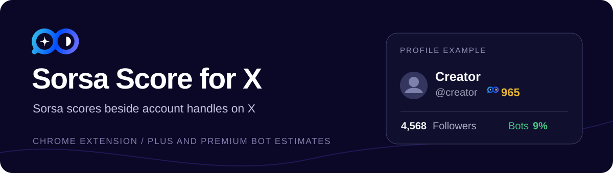

# Sorsa Score for X

A Chrome extension that shows [Sorsa](https://app.sorsa.io/) scores beside account handles on X (Twitter). Scores appear on profiles, posts, account lists, and hover cards. Click a score to open that account on Sorsa.

You **must sign in to Sorsa** in the same Chrome profile as the extension for scores to work. Sorsa Plus or Premium also enables bot follower estimates on X profile pages.

## Install in Chrome

1. Get the extension folder in either way:
   - **From the visible source, without a ZIP:** run `git clone https://github.com/marik8002/sorsa-score-for-x.git` and use the new `sorsa-score-for-x` folder.
   - **From a release archive:** download `sorsa-score-extension-v*.zip` from [Releases](https://github.com/marik8002/sorsa-score-for-x/releases) and extract it to a folder you plan to keep. Use the extension ZIP, not the source ZIP.
2. Confirm that `manifest.json` is directly inside the chosen folder.
3. Open `chrome://extensions` in Chrome and turn on **Developer mode**.
4. Click **Load unpacked** and select that folder.
5. Sign in at [app.sorsa.io](https://app.sorsa.io/) in the same Chrome profile, then open or reload an X page.

If you already have another version installed, disable it to avoid duplicate scores. Keep the selected folder in place: Chrome loads the extension from it.

## Use the extension

1. Open the extension popup. It shows whether your Sorsa session is ready. If it says **Sign in required**, use its **Sign in to Sorsa** link, complete the sign-in on Sorsa, and reopen the popup. **Refresh status** checks again if the popup still shows the old state.
2. Open a profile, post, account list, or hover card on [x.com](https://x.com/). The Sorsa score appears beside the account's handle. Click the score to open that account's Sorsa profile.
3. If you want fresh scores, click **Clear score cache** in the popup and reload the X page. Scores are normally cached for 24 hours.

### Sorsa Plus or Premium

For users with Sorsa Plus or Premium, **Show bots** is enabled by default in the extension popup. Turn it off there if you do not want bot estimates. On an X profile, the bot follower percentage appears beside the follower count. If no analysis exists yet, it shows **Bots —**. Use the refresh icon beside it to request an update from Sorsa. The previous estimate remains visible while Sorsa processes the request; the icon is disabled while updating or during Sorsa's cooldown. Hover over the estimate to see its last update date. Bot estimates are shown only on profile pages.

Without Plus or Premium, the **Show bots** option is disabled. Scores remain available with a signed-in Sorsa account.

## Privacy and cache

While an X tab is open, the extension quietly checks the Sorsa session every ten minutes. If Sorsa expires the session, sign in again to continue.

The extension reads account handles shown in X identity areas and requests their public Sorsa profiles using your existing browser session. It does not read or transmit post content, or read or store your password, session cookies, or API keys. Confirmed scores, the latest bot estimates, and the last confirmed Plus status are cached locally. Scores expire after 24 hours; use **Clear score cache** in the popup to fetch them again.

## Development

The extension source is in this repository. To run the tests, install [Node.js](https://nodejs.org/), then run `npm ci` and `npm test` from the repository root. To load the source directly for development, choose this repository's root folder in **Load unpacked**.
